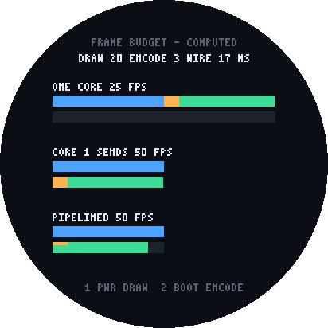
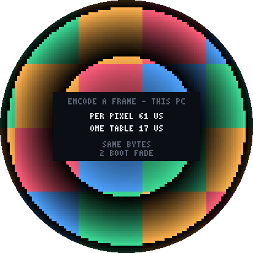

# Using both cores

The ESP32-S3 has two cores, and a frame on this board has two jobs that do not
need each other: drawing the picture, and getting it onto the panel. Put them
on different cores and a frame costs the longer of the two instead of their
sum. Doing that for [Pokewalker](https://github.com/Alchemy86/pokewalker) more
than doubled its frame rate on most screens:

| Screen | Before (fps) | After (fps) |
|---|---|---|
| Closed ball (a lit sphere, shaded per pixel) | 13.2 | 36.5 |
| Watch face | 13.8 | 39.7 |
| 3D park | 8.1 | 15.1 |
| Open world | 7-9 | 14-19 |
| Battle (a 3D floor) | 12.1 | 24.3 |

All measured on the board, from its own heartbeat line. On the closed ball the
encode alone went from 18.8 ms a frame to 2.7 ms.

The emulator cannot show any of this: it runs your code natively, about 150
times faster than the board (see [timing-and-audio.md](timing-and-audio.md)).
What it can do is show you the arithmetic, which is the `frame-budget` example,
and let you check the colour-table trick gives the same bytes, which is the
`colour-table` example. The board code is in [`board/`](../board/README.md):
`present.rs`, `lend.rs` and `rows.rs`. Like the rest of `board/`, nothing in
this workspace compiles them; they need `esp-hal` and the real chip.

## Where a frame's time goes

Four things, one after the other on a single core:

- **Draw.** Your code making the picture. Anything from a few ms to over 50.
- **Encode.** Turning the picture into the bytes the panel takes, 412 x 412
  dots of 65k colour: 339,488 bytes.
- **Send.** Those bytes over QSPI at 40 MHz on four lanes is 20 MB/s, so about
  **17 ms** of pure data, plus a command and address phase per write. Nothing
  you do in software shortens it; only sending less (a partial update, or
  65k colour rather than 16.7M) does.
- **Input.** The touch digitiser and the accelerometer, both on one I2C bus at
  100 kHz.

Pokewalker's closed ball before the change: a pass of 75.8 ms, of which
18.8 ms was encode and about 17 ms was the CPU waiting for the wire. The
draw was the smaller part.

```sh
cargo run --release --example frame-budget -- --print --draw 20 --encode 18.8
```

```text
a frame: 169744 pixels, 52 commands -> 17.1 ms on the wire at 40 MHz x 4 (computed)
draw 20.0 ms, encode 18.8 ms (given)
  one core          55.9 ms a pass   17.9 fps
  core 1 sends      35.9 ms a pass   27.9 fps
  pipelined         20.0 ms a pass   50.0 fps
```

<p align="center"> </p>

The wire time there is computed from the transfers the driver really issues
for a frame, not measured. The window draws the three passes as timelines;
PWR steps the draw time and BOOT swaps the encode.

## Core 1 sends the frame

Core 0 draws a frame, copies it into a snapshot, posts it, and goes straight on
to the next frame. Core 1 encodes and sends the snapshot. A frame now costs
`max(draw, encode + send)`.

Three details make it work:

- **A snapshot in PSRAM.** Core 0 needs its canvas back immediately, so core 1
  reads a copy. Copying a 10.6 KB indexed canvas is far cheaper than drawing
  it, and the copy lives in PSRAM, which is plentiful, so internal RAM stays
  free for the stack and the radio.
- **A one-slot mailbox, no lock.** One atomic byte, `IDLE` or `POSTED`, and one
  pointer. Core 0 writes the pointer only while `IDLE` and publishes with
  `Release`; core 1 reads it only while `POSTED`, loaded with `Acquire`, and
  sets it `IDLE` when the frame is on the panel. Core 0 waits for `IDLE` before
  posting again, and that wait is the only time it ever waits for core 1.
- **The wire does not change.** Core 1 sends the same `CASET`, `RASET`,
  `RAMWR`, `RAMWRC` sequence, with the same bytes, that `Spd2010::draw` would.
  It owns the bus outright, so there is nothing to arbitrate.

`board/present.rs` is the whole of it, with `hand_over` as core 0's side and
`Presenter::serve` as core 1's.

## One colour table a frame

If your picture is palette indices, the colour of a pixel depends only on its
index and on the palette and any fade or tint for this frame. So resolve and
encode all 256 indices once a frame, each as a run of four dots, and the inner
loop becomes a copy per pixel.

On the board that took a frame's encode from 18.8 ms to 2.7 ms. The example
runs both ways on every frame, checks they give the same bytes, and prints what
each costs on your desktop:

```sh
cargo run --release --example colour-table -- --bench 200
```

```text
format     per pixel us     table us     build us   faster
Rgb565               61           16            1     3.8x
```

The desktop ratio is smaller than the board's, because the desktop's per-pixel
path is cheap to begin with. The real per-pixel lookup on the board also
resolved ramps and palette slots through several branches; the table moved all
of it out of the loop. `roundpanel/tests/colour_table.rs` holds the two
encoders to identical bytes in all three pixel formats.

The emulator's own `Frame` is 24-bit colour with no palette, so this is a
technique for your application's canvas, not something the harness can do for
you.

## Pipelined half bands

Core 1 sending the frame removed the send from core 0, but core 1 still did
encode, then send, in series. The fix is to fill one buffer while the other is
on the wire.

The frame goes out in bands of 16 dot rows. Each band is two memory writes,
because the chip forbids a whole window on one `RAMWR` (p.50), and the driver
splits a window at half its pixels, rounded down to four. For 16 rows of 412
that is exactly 8 rows each side, so each half can be made straight into its
own DMA buffer. With two pairs of half-band buffers (6,592 bytes each), core 1:

1. sets the window for band *k* and starts its first half on the wire;
2. fills both halves of band *k + 1* into the other pair;
3. waits for the first half, starts the second;
4. moves on.

`EspQspi::start_colour` starts a DMA write and returns without waiting;
`finish` waits and hands the buffer back. Any command waits for a colour write
still in flight, so ordering on the wire is kept by construction. Core 1's
side of a frame becomes `max(encode, send)` plus one band's encode.

The driver needs one thing for this, `Spd2010::bus_mut`, so the host can send
pixel data its own way between the driver's commands.

## Lending the I2C bus

Once core 1 sends the frame, core 0 can only read the touch digitiser and the
accelerometer between pictures. A picture of 50 ms is too long to go without a
sample: a software pedometer wants 25 a second or more
([imu-and-steps.md](imu-and-steps.md)).

So core 0 lends core 1 the I2C bus and both drivers for the length of each
picture. Core 1 reads them between its own bands on the same cadence (every
15 ms), and stores each reading with the time it was taken in a
single-producer, single-consumer ring. When the picture is done, core 0 takes
the bus back and replays the readings, oldest first, through the same touch
and step handlers it would have called had it read them itself at those
times.

The loan is one atomic byte with three states: `OWNED` by core 0, `LENT`, and
`BUSY` while core 1 is mid-reading. Core 1 can only take `BUSY` from `LENT`;
core 0 can only reclaim from `LENT`. So the bus never changes hands in the
middle of a transaction, and nobody takes a lock. `board/lend.rs`.

## Splitting rows between cores, and when not to

A long picture can be drawn on both cores at once: both take row numbers from
one shared atomic counter until there are none left. Two rules keep the
picture identical to the one-core drawing:

- Each row is made into a side buffer, not the canvas, and core 0 then sets
  the canvas from it row by row, left to right: the same calls in the same
  order as before.
- A row reads only what was on the canvas before the picture started.

Then the output cannot change, only how soon it is ready. Prove it with a
frame hash, one core against two. `board/rows.rs` has the code; on the desktop
an `Assist` is two `std::thread::scope` threads on the same counter, which is
how the test runs.

**It only pays when core 1 is free.** On this board core 1 is usually sending
the last frame, so rows offered to it are rows taken from the send.
Pokewalker shared the rows of its closed ball and measured it slower,
and took it out. On the 3D ground and the battle floor, where one picture takes
longer than a whole send, core 1 runs out of frame to send and the shared rows
win. Measure each screen; the heartbeat's row count tells you whether core 1
helped at all.

## How to measure

Print one line a second from core 0: each time is ms a frame, to a tenth,
averaged over that second.

```text
perf pass P draw D wait W enc E tx T touch U ms | SCREEN | sent N polls A+B rows on core 1 R
```

- `pass`: the whole loop, the number that sets the frame rate.
- `draw`: core 0 making the picture.
- `wait`: core 0 waiting for the mailbox. Near zero means core 1 keeps up;
  large means the send, not the draw, sets the pace.
- `enc`, `tx`: core 1's encode and wire time a frame, accumulated in atomics
  core 1 adds to and core 0 reads.
- `touch`: core 0's own I2C reads.
- `sent`: frames core 1 put on the panel. `polls A+B`: readings by core 0 and
  by core 1 on loan. `rows on core 1`: rows it drew for core 0.

Read the stage's numbers before changing anything. If `wait` is large, a
faster draw will not help; if `rows on core 1` stays near zero, the sharing is
only overhead.

## The rules core 1 must follow

- **Never print, never take the console lock.** `println!` takes a lock that
  core 0 also takes, and core 1 can be stopped while holding it (next rule).
  Core 1 publishes numbers in atomics; core 0 prints them.
- **A flash write parks core 1.** Code runs from flash, and a write makes flash
  unreadable, so `FlashStorage::multicore_auto_park()` stops core 1 wherever
  it is for the write ([flash-storage.md](flash-storage.md)). A frame in
  flight is only delayed. Anything core 1 holds when parked, core 0 must not
  need.
- **A 16 KB stack.** `Stack<16_384>`, in internal RAM. Everything big core 1
  touches is a static or a box: the snapshot, the DMA buffers, the presenter.
- **Internal RAM before PSRAM.** Register the internal heap first and PSRAM
  second; the radio's own allocations need internal RAM
  ([wifi.md](wifi.md)). Put the large, slow-to-change things in PSRAM: the
  snapshot, row buffers, caches.
- **No locks anywhere between the cores.** Every hand-off here is one atomic
  state byte with `Release`/`Acquire`, and each side only touches the shared
  slot in the states that make it its own.
- **Keep the sound engine fed.** If core 1 also runs audio, call its poll
  between bands and between shared rows, as `Presenter::serve` does with its
  `between` callback.

## Where to read more

- Pokewalker: `software/pw-pet-firmware/src/present.rs`, `lend.rs`, `qspi.rs`
  and the heartbeat in `main.rs`; `software/pw-world/src/roam.rs` (`Assist`)
  and `software/pw-pet/src/twocore.rs` (`Rows`).
- [timing-and-audio.md](timing-and-audio.md) for the audio engine that shares
  core 1 with the panel.
